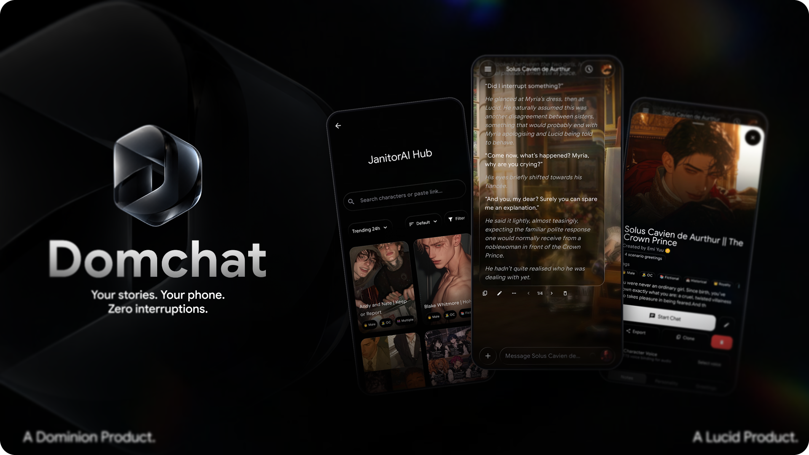
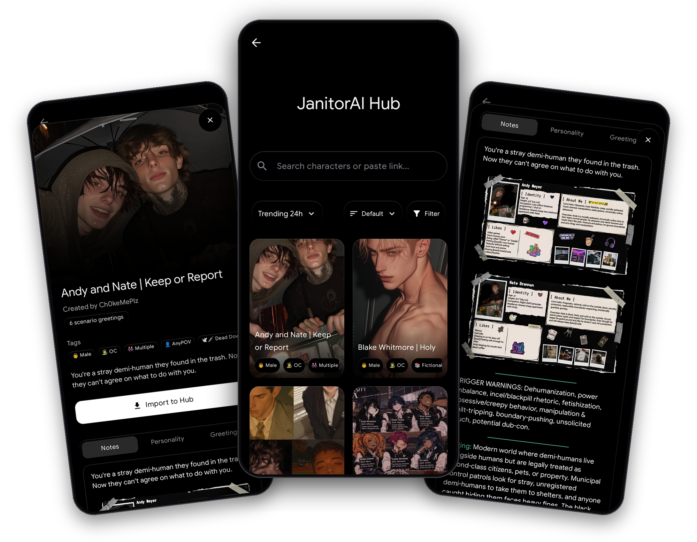
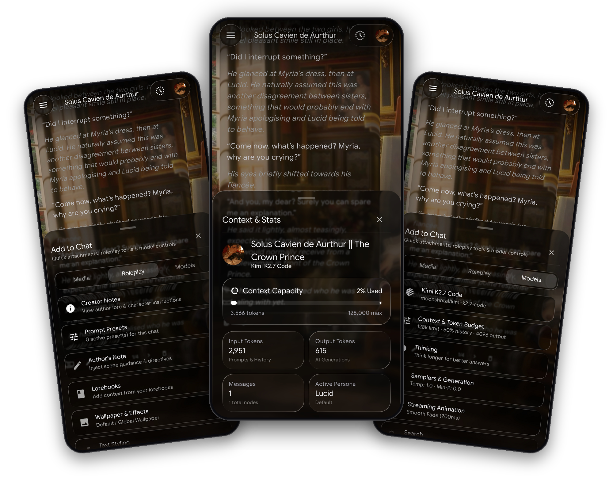
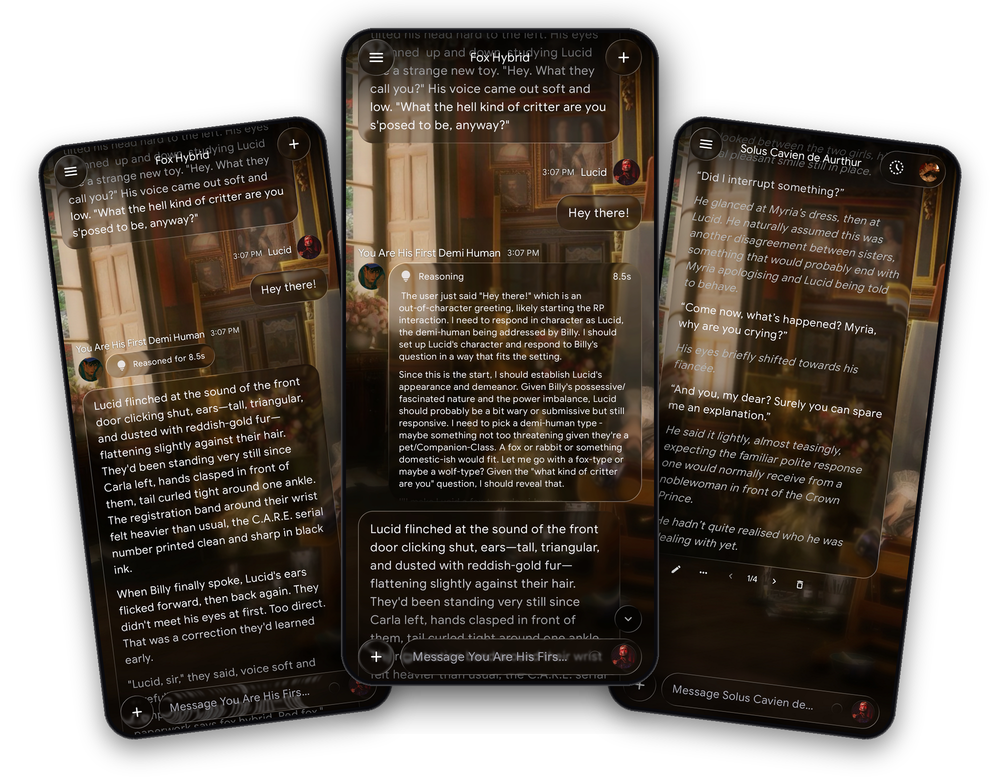

 

# Domchat

**A native Android roleplay app built for immersion, privacy, and actually owning your chats.**

  
  
  

**[Download Latest APK](https://github.com/DomcordFr/Domchat/releases/latest)** · **[Join our Discord](https://discord.gg/domcord)** · **[Quickstart Guide](#getting-started-in-2-minutes)** · **[Open Source & Privacy](#what-is-open-source-and-what-is-not)**

---

If you roleplay on your phone, you have probably felt stuck between frustrating options:

- **Roleplay websites (like JanitorAI)** have amazing character libraries, but using them on a phone means dealing with ads inside your chats, pop-ups that break the mood, browser tabs reloading and deleting your half-written reply, slow peak-hour queues, and the constant worry that a site outage or deleted bot will take your story with it.
- **Power-user frontends (like SillyTavern)** give you freedom and privacy, but getting them working on Android means installing Termux, setting up Node.js, running terminal commands, and fighting a desktop layout crammed onto a phone screen.
- **Commercial RP apps** feel smooth at first, until they hit you with subscriptions, ads, strict filters, and accounts that keep your stories locked on someone else's servers.

**Domchat is the simple way out.** It is a clean, lightweight, native Android app with a low barrier of entry. Install the APK, connect your AI provider, pull in your favorite bots directly from JanitorAI Hub, and get back to your story.

---

## Why Switch to Domchat?

| What Matters | Websites (JanitorAI, etc.) | Power Tools (SillyTavern on Android) | Commercial RP Apps | Domchat (Native Android) |
| :--- | :--- | :--- | :--- | :--- |
| **Ease of Setup** | Account required | Hard (Termux, Node.js, terminal) | Account required | **Install APK and go (2 minutes)** |
| **Mobile Experience** | Clunky browser tabs that reload | Desktop web UI on a small screen | Native app | **Native Android, AMOLED & Liquid Glass** |
| **Ads & Paywalls** | In-chat ads & promo pop-ups | None | Subscriptions & ads | **Zero ads. Zero paywalls.** |
| **Chat Ownership** | Stored on third-party servers | Local | Stored on their servers | **100% local on your phone** |
| **Characters** | Huge web library | Manual card hunting & importing | Closed platform bots | **Built-in JanitorAI Hub + SillyTavern cards** |
| **Outages & Queues** | Downtime & slow peak queues | Depends on your API | Rate limits & lag | **Direct APIs & custom proxies** |

---

## Moving from JanitorAI Takes Seconds

The biggest reason people stay on a roleplay website is that they do not want to lose their favorite bots. With Domchat, you bring them with you.

### Built-In JanitorAI Hub
Domchat comes with **JanitorAI Hub** built right in. You can browse and import bots directly from JanitorAI straight into your app in a tap. Once a bot is imported, it is saved locally on your phone. Even if the website goes down or a creator removes a bot later, your local copy and your entire chat history stay right where you left them.

Already have a folder of SillyTavern cards? Domchat also supports importing standard **Character Card V2** (`.png` with embedded metadata and `.json`) files straight from your device storage.

---

## Everything You Expect from a Roleplay App (Plus More)

Domchat gives you the tools that make long stories shine, without burying you in confusing menus.

### Personas That Stay Consistent
Create as many user personas as you want, each with its own name, avatar, background, appearance, and pronouns. Switch personas anytime depending on the scene, and characters naturally keep track of who you are playing.

### Lorebooks (World Info) & Smart Memory
Long roleplays break down when bots forget side characters, locations, or plot points. Attach **Lorebooks** that automatically inject world details the moment matching keywords show up in your chat. Paired with **Context Budget** controls, **RP Optimizations**, and **Character Notes**, your stories stay consistent across hundreds of messages.

### Swipe, Branch, Edit, and Steer the Scene
- **Swipe for Alternate Replies**: Not feeling a response? Swipe left or right on any reply to generate a new take without losing earlier versions.
- **Full Message Control**: Edit any message (yours or the character's), rewind the scene, or guide the story wherever you want it to go.
- **Presets & Prompt Injections**: When you are ready to fine-tune writing style, temperature, or Author's Notes, full generation presets and prompt controls are waiting for you in Settings, tucked cleanly out of the way for beginners.

### Built for Immersion: AMOLED Black & Liquid Glass
Domchat is built to keep you inside the story, not staring at a sterile chatbot box.
- **Pure AMOLED Black** background that looks sharp and feels comfortable for late-night reading.
- **Liquid Glass** translucent cards and controls with customizable blur and transparency.
- **Custom Wallpapers & Fonts** so every chat can match the mood of your story.
- **Native Android Smoothness** with tactile haptics, zero browser bars, zero accidental back-swipes, and zero tab reloads eating your drafts.

### Bring Your Own AI
Connect your own API keys or proxies with a clean provider manager: **OpenRouter**, **Nano-GPT**, **Featherless**, **DeepSeek**, **Claude**, **OpenAI**, or any OpenAI-compatible endpoint.

### Character Voices
Bring scenes to life with natural voice playback using **Fish Audio**, **ElevenLabs**, **OpenAI Audio**, or free built-in **Android System Voices**. Tap the speaker icon on any message and control playback from a floating glass player.

### True Local Ownership & One-Tap Backups
There are no Domchat accounts, no central servers holding your chats, and no tracking scripts. Every chat, character, persona, wallpaper, and lorebook lives on your phone. You can export a complete lossless backup of your entire setup anytime and restore it whenever you switch devices.

---

## Getting Started in 2 Minutes

You do not need any coding experience or terminal commands.

### 1. Download & Install
Grab the latest APK straight from the **[Latest Release](https://github.com/DomcordFr/Domchat/releases/latest)** page and install it on your Android phone.

### 2. Connect an AI Provider
1. Open Domchat and go to **Settings > Providers**.
2. Tap **+** and choose a provider (such as **OpenRouter**, **Nano-GPT**, **Featherless**, **DeepSeek**, **Claude**, or **OpenAI**). *(Tip for beginners: OpenRouter has free models you can test right away with a free account.)*
3. Paste your API key, tap **Save**, and pick the models you want available in chat.

### 3. Import Your First Character
- Open **JanitorAI Hub** inside the app to search and import any bot directly from JanitorAI.
- Or open the **Characters** tab, tap **Import**, and select any SillyTavern `.png` or `.json` character card from your phone.

### 4. Create Your Persona (Optional)
Go to **Settings > Personas**, tap **Add Persona**, and add your name, avatar, and a short description so characters know who you are in the scene.

---

## What Is Open Source (and What Is Not)

We want to be completely honest about how Domchat is built and where your data goes:

- **Open Source (The Domchat Android App)**: The entire Domchat Android application is open source right here on GitHub. Anyone can read the code, audit it, or compile the APK themselves to verify that there are no ads, no analytics trackers, and no hidden chat logging. Your chats stay on your phone and go directly to the AI provider you pick.
- **Closed Source (The JanitorAI Extraction Backend)**: The hosted backend service that powers **JanitorAI Hub** (used to fetch and import bot cards from JanitorAI) is closed source. We keep this extraction backend closed to keep bot importing working reliably and prevent abuse. Using JanitorAI Hub is completely optional: if you only import local character cards or create your own bots, Domchat never talks to that backend at all.

---

## Community & Links

Have questions, need help picking an API provider, or want to share feedback and feature ideas?

- **Download Latest Version**: [GitHub Releases (Latest)](https://github.com/DomcordFr/Domchat/releases/latest)
- **Discord Community**: [discord.gg/domcord](https://discord.gg/domcord)
- **Creator's JanitorAI Profile**: [Lucid on JanitorAI](https://janitorai.com/profiles/20394fdf-c461-468d-a720-db53940be487_profile-of-lucid-67)
- **Creator's Discord**: [Message Lucid on Discord](https://discord.com/users/725960339547488308)

---

## Credits

Domchat is a fork of [LastChat](https://github.com/Cocolalilal/LastChat). Huge thanks to the original project for laying the foundation.
